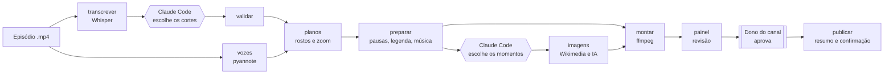

<p align="center">
  <picture>
    <source media="(prefers-color-scheme: dark)" srcset="docs/marca/clipline/clipline-logo.svg">
    
  </picture>
</p>

<p align="center">
  De um episódio gravado a cortes verticais prontos para publicar: legenda, zoom em quem fala,
  música e imagens, revisados num painel web antes de qualquer envio.
</p>

<p align="center">
  
  
  
  
  
  
  <a href="https://github.com/gabrielmrezende/clipline/actions/workflows/testes.yml"></a>
  <a href="LICENSE"></a>
</p>

---

O **clipline** é a esteira de cortes do canal **Tudo é Política**. Ela recebe um episódio
horizontal (entrevista ou bate-papo) e entrega de 8 a 10 cortes verticais em 1080x1920 e 30 fps,
prontos para TikTok, YouTube Shorts e Instagram Reels.

O trabalho é dividido em três partes:

- **A CLI em Python** faz o trabalho mecânico e repetível: transcrever, achar quem fala, enquadrar,
  limpar pausas, legendar, pôr música e imagens e renderizar.
- **O [Claude Code](https://claude.com/claude-code)** faz o trabalho de julgamento numa sessão
  interativa, seguindo regras escritas: quais trechos viram corte, onde entra cada imagem, os textos
  dos posts e o calendário.
- **O dono do canal** revisa e aprova no painel. Nada é publicado sem um sim dele ao resumo da
  publicação.

> [!NOTE]
> O projeto nasceu para um canal só e ainda carrega isso: os nomes das pastas, as regras
> editoriais (que ficam fora do repositório) e o encerramento são os do Tudo é Política. Tornar
> tudo configurável está no [roadmap](#roadmap).

## Sumário

- [Destaques](#destaques)
- [Como funciona](#como-funciona)
- [Tecnologias](#tecnologias)
- [Requisitos](#requisitos)
- [Instalação](#instalação)
- [Uso](#uso)
- [Claude Code](#claude-code)
- [Painel de revisão](#painel-de-revisão)
- [Testes](#testes)
- [Estrutura do repositório](#estrutura-do-repositório)
- [Princípios de projeto](#princípios-de-projeto)
- [Documentação](#documentação)
- [Roadmap](#roadmap)
- [Contribuindo](#contribuindo)
- [Segurança e credenciais](#segurança-e-credenciais)
- [Créditos de terceiros](#créditos-de-terceiros)
- [Licença](#licença)

## Destaques

- **Transcrição com tempo por palavra.** faster-whisper `large-v3` na GPU, com um glossário para
  acertar nomes próprios.
- **Zoom em quem fala.** A diarização (pyannote) diz quem fala e quando; os rostos (YuNet e SFace)
  dizem onde a pessoa está. A esteira calcula o enquadramento vertical de cada trecho e gera folhas
  de contato para conferir.
- **Corte limpo.** Remove pausas, hesitações e repetições e lista cada remoção em `edicoes.md`. Uma pausa só sai se
  o áudio confirmar o silêncio: riso, "uhum" ou fala que a transcrição perdeu ficam no corte.
- **Legenda queimada no vídeo**, com uma cópia `.srt` editável e correção do texto pelo painel. Opcional: a palavra
  falada acende, no estilo dos Shorts.
- **Música por clima.** Uma biblioteca de faixas livres (Kevin MacLeod, CC BY 4.0), volume ajustável
  e crédito escrito automaticamente nos textos dos posts.
- **Imagens ilustrativas no vídeo:**
  - fotos de licença livre do Wikimedia Commons, com crédito;
  - cartões de notícia no estilo do canal;
  - imagens de IA (OpenAI ou Google), com aprovação do prompt e do custo antes de gerar e bloqueio
    de prompts que citam pessoas reais.
- **Painel de revisão no navegador**, que também abre no celular pela mesma Wi-Fi: vídeo com a
  "linha do corte", troca de música com prévia, escolha das imagens, edição dos posts com limite de
  caracteres, calendário e botão de aprovar.
- **Publicação com trava.** YouTube, Instagram e TikTok, sempre a partir de um resumo que o dono
  confirma, pelo painel ou pelo terminal. O YouTube recebe o vídeo na hora; Instagram e TikTok entram numa fila que o
  Agendador de Tarefas do Windows publica no horário. Vídeo com imagem de IA vai com o rótulo nativo de conteúdo
  sintético (YouTube e TikTok direto), e foto livre no vídeo exige o crédito nos textos.
- **Agente com travas de verdade.** O Claude Code segue `CLAUDE.md` e skills versionadas, e um hook impede que ele
  publique, gaste, sobrescreva ou toque em credenciais, mesmo se for induzido a isso por um texto que leu.
- **Cuidado com os arquivos.** A gravação é confinada a duas pastas, nada é sobrescrito sem
  `--forcar` e um corte com erro não derruba os outros.

## Como funciona



Retângulos são comandos da CLI; hexágonos, decisões do Claude Code; colchetes duplos, decisões do
dono do canal.

As etapas conversam por arquivos JSON e Markdown na pasta de cada episódio (`palavras.json`,
`vozes.json`, `aprovados.json`, `montagem.json`, `pedidos.json`...). Cada etapa pode ser refeita
sozinha, e o estado nunca fica só em memória.

## Tecnologias

| Peça | Para quê |
|---|---|
| Python 3.12 | A esteira (`esteira/`) e a CLI |
| ffmpeg e ffprobe | Corte, filtros, medição de áudio e render; usa NVENC (`h264_nvenc`) e recua para `libx264` |
| faster-whisper `large-v3` | Transcrição com tempo por palavra (CUDA) |
| pyannote `speaker-diarization-3.1` | Quem fala e quando (CUDA, opcional) |
| OpenCV YuNet e SFace | Detecção de rostos e a mesma pessoa entre cenas |
| Pillow | Folhas de contato, cartões de notícia e preparo das fotos |
| Wikimedia Commons API | Fotos com licença livre |
| OpenAI e Google (Gemini) | Imagens de IA, só com aprovação |
| FastAPI e uvicorn | API do painel |
| React 18, TypeScript e Vite | Interface do painel |
| pytest, Vitest e Playwright | Testes |

## Requisitos

- **Windows 10 ou 11** para o uso completo. O Agendador de Tarefas e o Gerenciador de Credenciais são usados na
  publicação. A esteira, o painel e os testes também rodam em Linux (é o que a CI usa).
- **Python 3.12** (testado também no 3.13).
- **GPU NVIDIA com CUDA 12** para a transcrição e as vozes. A esteira roda em uso real numa RTX 4060
  de 8 GB.
- **ffmpeg e ffprobe** para Windows, de preferência com NVENC.
- **Node.js 18 ou mais novo**, só para gerar o build do painel.
- **Claude Code**, para as etapas de julgamento. Os arquivos que ele grava (`aprovados.json`,
  `pedidos.json`, `post.md`) também podem ser escritos à mão.
- **Opcional:** um token do Hugging Face com acesso ao `pyannote/speaker-diarization-3.1`, para o
  comando `vozes`.

## Instalação

**1. Crie a pasta do projeto e clone o repositório dentro dela.** A esteira usa a pasta *acima* do
clone como raiz e espera estas irmãs:

```powershell
mkdir "Meu Canal"; cd "Meu Canal"
git clone https://github.com/gabrielmrezende/clipline.git Automacao
mkdir "1 - Programas", "2 - Cortes", "3 - Identidade", "Contexto"
```

```text
Meu Canal/
├── 1 - Programas/    episódios gravados (a esteira só lê)
├── 2 - Cortes/       saída: uma pasta por episódio, uma subpasta por corte
├── 3 - Identidade/   logo e vídeos de encerramento
├── Contexto/         regras editoriais do canal (Markdown) e glossario.md
└── Automacao/        este repositório
```

**2. Crie o ambiente Python e instale o pacote:**

```powershell
cd Automacao
py -3.12 -m venv .venv
.venv\Scripts\python.exe -m pip install -e ".[painel,dev]"
Copy-Item -Recurse Contexto.exemplo ..\Contexto      # modelos das regras do canal; reescreva com as suas
.venv\Scripts\clipline.exe doctor                    # confere ffmpeg, GPU, modelos, chaves e pastas
```

Opcional: copie `clipline.exemplo.toml` para `clipline.toml` para mudar a duração dos cortes, a identidade do canal,
o estilo da legenda e a normalização da voz.

Para o comando `vozes`, instale também o `torch` 2.5.1 com CUDA (veja o comando certo em
[pytorch.org](https://pytorch.org/get-started/previous-versions/)), o `torchaudio` 2.5.1,
`"pyannote.audio>=3.1,<4"` e `"huggingface_hub>=0.30,<1.0"`.

**3. Coloque os binários e os modelos, que não vão para o git:**

- `bin/ffmpeg.exe` e `bin/ffprobe.exe`;
- em `modelos/`, os arquivos `face_detection_yunet_2023mar.onnx` e
  `face_recognition_sface_2021dec.onnx` do [OpenCV Zoo](https://github.com/opencv/opencv_zoo). O
  [`modelos/LEIA.md`](modelos/LEIA.md) tem os links.

**4. Monte a biblioteca de música.** O git guarda só o catálogo (`musicas/catalogo.json`), com o
caminho `clima/nome.mp3`, a duração e o crédito de cada uma das 40 faixas; os `.mp3`, todos do
[incompetech.com](https://incompetech.com), ficam fora. Para escolher faixas novas,
`musicas propor` sugere uma seleção por clima, e `musicas baixar` baixa as aprovadas em
`musicas/aprovadas.json` que ainda não estão no catálogo.

**5. Gere o build do painel:**

```powershell
cd painel-web
npm install
npm run build   # o build vai para esteira/painel/estatico/
```

## Uso

Todos os comandos seguem o formato `.venv\Scripts\python.exe -m esteira <comando>`. Os que agem
sobre um episódio recebem a pasta dele em `2 - Cortes/` e aceitam `--numero N` para um corte só.
O resultado sai por corte: `ok`, `ok com alertas: ...` ou `erro: ...`.

| # | Etapa | Comando | O que faz |
|---|---|---|---|
| 1 | Transcrever | `transcrever <vídeo> --quadro Q --numero N --convidado C` | Cria a pasta do episódio e a transcrição com tempo por palavra |
| 2 | Vozes | `vozes <vídeo> <pasta>` | Quem fala e quando |
| 3 | Escolher | *Claude Code* | Escolhe os trechos e grava `aprovados.json` |
| 4 | Validar | `validar <pasta>` | Confere os cortes escolhidos |
| 5 | Enquadrar | `planos <pasta>` | Rostos, quem fala e zoom, com a folha `planos.jpg` para conferir |
| 6 | Preparar | `preparar <pasta>` | Pausas, legenda e música; grava a receita `montagem.json` |
| 7 | Imagens | `imagens buscar\|resumo\|sugerir\|gerar <pasta>` | Candidatas do Wikimedia, resumo do download, fotos preparadas e imagens de IA |
| 8 | Montar | `montar <pasta>` | Renderiza o `corte.mp4` de cada corte |
| 9 | Textos | *Claude Code* | `post.md` de cada corte e `calendario.md` |
| 10 | Revisão | `revisao <pasta>` | Resumo do episódio em `revisao.md` |
| 11 | Aprovar | `painel` | Revisão e aprovação no navegador |
| 12 | Publicar | `publicar agendar <pasta> --numero N --data "AAAA-MM-DD HH:MM"` | Mostra o resumo; com `--confirmar`, envia |

Comandos de apoio:

- `status [<pasta>]`: em que etapa está cada corte e qual o próximo comando (`--json` para o painel e o agente).
- `trecho <pasta> --de S --ate S`: palavras, tempos e quem fala de um intervalo do episódio.
- `doctor`: confere o ambiente.
- `validar <pasta> --json`: confere todos os arquivos que o agente escreve e diz arquivo, campo e correção.
- `musica <pasta>`: troca a música de um corte já montado.
- `musicas propor|baixar`: monta a biblioteca de música.
- `cartao`: gera um cartão de notícia avulso.
- `publicar conectar|fila|rodar|cancelar|marcar|instalar-tarefa`: contas, fila e tarefa de
  publicação.

Exemplo do começo de um episódio:

```powershell
.venv\Scripts\python.exe -m esteira transcrever "..\1 - Programas\Entre Assuntos 03.mp4" --quadro "Entre Assuntos" --numero 3 --convidado "Nome do Convidado"
.venv\Scripts\python.exe -m esteira vozes "..\1 - Programas\Entre Assuntos 03.mp4" "..\2 - Cortes\Entre Assuntos 03 - Nome do Convidado"
```

O passo a passo completo, com as pausas para confirmação, está em
[`docs/operacao.md`](docs/operacao.md).

## Claude Code

A integração com o agente está no repositório:

| Arquivo | Para quê |
|---|---|
| [`CLAUDE.md`](CLAUDE.md) | Regras invioláveis e como economizar contexto |
| [`.claude/hooks/travas.py`](.claude/hooks/travas.py) | Hook `PreToolUse`: nega confirmar, sobrescrever, credenciais e pastas protegidas |
| [`.claude/skills/`](.claude/skills) | `escolher-cortes`, `momentos-de-imagem`, `textos-e-calendario` |
| [`.claude/commands/`](.claude/commands) | `/episodio`, `/corrigir-corte`, `/agendar` |
| [`docs/esquemas/`](docs/esquemas) | Formato dos arquivos que o agente grava |
| [`Contexto.exemplo/`](Contexto.exemplo) | Modelos das regras editoriais do canal |

Abra o Claude Code dentro de `Automacao/`. As pastas irmãs entram pelo `.claude/settings.json`. Detalhes e limites em
[`docs/seguranca-do-agente.md`](docs/seguranca-do-agente.md).

## Painel de revisão

```powershell
.venv\Scripts\python.exe -m esteira painel          # http://127.0.0.1:8765
.venv\Scripts\python.exe -m esteira painel codigo   # cria o código de acesso (uma vez)
.venv\Scripts\python.exe -m esteira painel --rede   # abre para o celular na mesma Wi-Fi
```

- **Monitor:** o vídeo em pé, fixo ao lado da página, e a **linha do corte** embaixo dele, uma
  régua do tempo que mostra onde entra cada imagem e leva o player até lá com um clique.
- **Música:** biblioteca por clima, prévia de 15 segundos no ponto do vídeo, volume e remontagem
  em fila.
- **Imagens:** cada momento aparece como uma linha de roteiro. Dá para escolher fotos, buscar
  outras, aprovar prompts de IA (com o custo antes), escolher a versão que vai para o vídeo e
  montar de novo.
- **Legenda:** o texto de cada tela, com um clique para ir ao tempo dela e o botão de montar de novo.
- **Post:** títulos, descrições e legendas com contador de limite por rede, avisos e proteção
  contra edição simultânea.
- **Publicar:** data, redes, o mesmo resumo do `publicar agendar` e a confirmação; a fila do corte com cancelar.
- **Aprovar:** copia o corte para `video-final/corte-aprovado.mp4`, que é o vídeo que a publicação
  usa.
- Tema claro e escuro, uso pelo teclado e movimento reduzido quando o sistema pede.

Detalhes em [`docs/painel.md`](docs/painel.md).

## Testes

```powershell
.venv\Scripts\python.exe -m pytest -n auto   # esteira e API do painel (mais de 1.000 testes; Windows, Linux e CI)

cd painel-web
npm test                             # componentes do painel (Vitest)
npx playwright install chromium      # uma vez
npm run e2e                          # ponta a ponta, com um episódio falso
```

Os testes não usam GPU, rede nem vídeos do canal. Modelos, APIs e downloads entram como
dependências trocáveis por falsos, e o ffmpeg de `bin/` gera vídeos sintéticos de poucos segundos
quando é preciso. O teste com os modelos de rosto reais é pulado se os `.onnx` não estiverem em
`modelos/`. Nos testes de ponta a ponta, o painel roda com montagem e geração de imagem falsas, e o
teste das imagens falha se a página tentar acessar a internet.

## Estrutura do repositório

```text
Automacao/
├── CLAUDE.md             regras do agente
├── .claude/              hook das travas, skills e comandos do Claude Code
├── Contexto.exemplo/     modelos das regras editoriais do canal
├── clipline.exemplo.toml configuração do canal (opcional)
├── esteira/              pacote Python
│   ├── cli.py            ponto de entrada, um subcomando por etapa
│   ├── transcrever.py, vozes.py, rostos.py, pessoas.py, enquadrar.py, planos.py
│   ├── limpeza.py, legenda.py, receita.py, musica.py, montar.py, render.py
│   ├── pedidos.py, wikimedia.py, imagens.py, imagens_no_video.py, cartao.py
│   ├── contrato.py, falantes.py, diagnostico.py, config.py
│   ├── imagens_ia/       provedores de imagem de IA
│   ├── painel/           API FastAPI do painel e fila de tarefas
│   └── publicar/         YouTube, Instagram, TikTok, fila e Agendador
├── painel-web/           interface do painel (React + TypeScript + Vite)
├── tests/                testes da esteira e da API
├── docs/                 operação, arquitetura, specs, planos e resultados
├── musicas/              catálogo e uso da biblioteca (os .mp3 ficam fora do git)
├── modelos/              modelos de rosto (os .onnx ficam fora do git)
├── assets/               fonte da legenda e imagem do encerramento
└── pyproject.toml
```

## Princípios de projeto

1. **Regras editoriais fora do código.** O estilo do canal fica em `Contexto/*.md` e orienta o
   Claude Code. O código só lê o glossário de nomes.
2. **Cada etapa grava em disco e pode ser refeita sozinha.**
3. **Nada é sobrescrito sem `--forcar`**, para proteger as edições feitas à mão.
4. **Um corte com erro não derruba os outros.**
5. **Escrita confinada.** A esteira recusa gravar fora de `2 - Cortes/` e da própria pasta.
   `1 - Programas/` é só leitura.
6. **Humano no fim.** Só o dono aprova um corte, e publicar exige um sim dele ao resumo.
7. **Lógica pura separada de I/O.** Enquadramento, limpeza e legenda recebem dados e devolvem
   dados; o que toca modelo, ffmpeg ou rede é injetado e pode ser trocado por um falso nos testes.

## Documentação

| Documento | Conteúdo |
|---|---|
| [`docs/operacao.md`](docs/operacao.md) | Passo a passo de um episódio, do vídeo à publicação |
| [`docs/painel.md`](docs/painel.md) | Instalar, abrir e usar o painel |
| [`docs/arquitetura.md`](docs/arquitetura.md) | Módulos, arquivos entre etapas e decisões (escrito antes do painel) |
| [`docs/superpowers/specs/`](docs/superpowers/specs) | Especificação de cada funcionalidade |
| [`docs/superpowers/plans/`](docs/superpowers/plans) | Planos de implementação |
| [`docs/resultados/`](docs/resultados) | Medições e testes com episódios reais |
| [`docs/seguranca-do-agente.md`](docs/seguranca-do-agente.md) | Travas do agente, defesa do painel e limites |
| [`docs/esquemas/`](docs/esquemas) | JSON Schema dos arquivos que o agente grava |
| [`docs/auditoria/`](docs/auditoria) | Auditorias do projeto e o que falta fazer |
| [`CHANGELOG.md`](CHANGELOG.md) | O que mudou em cada versão |

## Roadmap

- [x] Esteira completa: transcrição, vozes, enquadramento, limpeza, legenda, música e render
- [x] Imagens: Wikimedia, cartões de notícia e IA com aprovação, já dentro do vídeo
- [x] Painel de revisão: vídeos, posts, calendário, música, imagens e aprovação
- [x] Publicação no YouTube, Instagram e TikTok com resumo e confirmação
- [x] Licença MIT
- [x] Painel, fase 2: agendar pela tela e acompanhar a fila do corte
- [x] Integração com o Claude Code versionada, com travas por hook
- [x] Integração contínua com os testes
- [x] `clipline.toml` para duração, identidade, legenda e voz
- [ ] Painel, fase 3: editor de cortes com a transcrição clicável
- [ ] Configuração completa por canal (pastas e encerramentos)
- [ ] Instalação com um comando e publicação agendada fora do Windows
- [ ] Acompanhamento suave do rosto e tela dividida

O que falta, com prioridade e motivo, está em [`docs/auditoria/`](docs/auditoria).

## Contribuindo

Sugestões e correções são bem-vindas.

Veja [`CONTRIBUTING.md`](CONTRIBUTING.md). Em resumo:

1. Abra uma issue descrevendo o problema ou a ideia antes de um pull request grande.
2. Crie um branch a partir do `master`.
3. Mantenha os testes passando (`pytest` e `npm test`) e escreva testes para o que mudar.
4. Use mensagens no formato [Conventional Commits](https://www.conventionalcommits.org/pt-br/), em
   português (`feat:`, `fix:`, `docs:`, `refactor:`).
5. Não envie vídeos, músicas, modelos, chaves ou dados de canal.

O código, os comentários e a interface são em português.

## Segurança e credenciais

- Nenhuma chave fica em arquivo. As chaves das APIs de imagem e das redes sociais ficam no
  Gerenciador de Credenciais do Windows (via `keyring`); o token do Hugging Face vem da variável
  `HF_TOKEN` e aparece mascarado nas mensagens de erro.
- O painel abre só em `127.0.0.1`. Na rede local (`--rede`), ele exige o código de acesso, com trava por aparelho, e
  a sessão dura 7 dias. Pedidos vindos de outra página são recusados e as respostas levam CSP.
- O agente não confirma nada: ver [`docs/seguranca-do-agente.md`](docs/seguranca-do-agente.md) e
  [`SECURITY.md`](SECURITY.md).
- Gerar imagem de IA e publicar sempre mostram um resumo com o custo ou o destino antes de agir.

## Créditos de terceiros

| Item | Autor e licença | No repositório? |
|---|---|---|
| Músicas | Kevin MacLeod ([incompetech.com](https://incompetech.com)), CC BY 4.0 | Só o catálogo |
| Fonte da legenda: Montserrat | Julieta Ulanovsky e colaboradores, SIL OFL 1.1 | Sim (`assets/fonts/`) |
| Fonte do painel: Schibsted Grotesk | Bakken & Bæck para a Schibsted, SIL OFL 1.1 | Pelo npm (`@fontsource-variable`) |
| YuNet e SFace | OpenCV Zoo, MIT e Apache 2.0 | Não |
| Fotos | Wikimedia Commons, licença de cada arquivo, creditada nos posts | Não |

## Licença

O código está sob a [licença MIT](LICENSE). Os itens de terceiros listados acima seguem as
próprias licenças. As marcas **Tudo é Política** (incluindo o encerramento em `assets/`) e
**clipline** (`docs/marca/`) não fazem parte da licença do código.

---

<p align="center">
  Feito por <a href="https://github.com/gabrielmrezende">gabrielmrezende</a> para o canal Tudo é Política.
</p>
