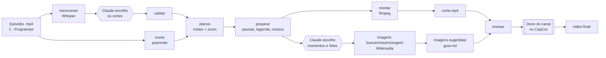
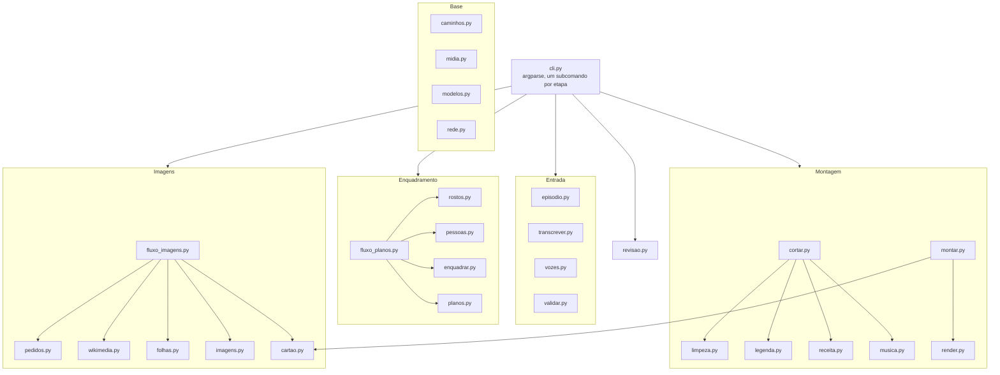
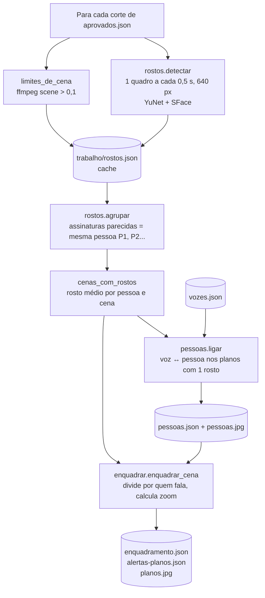
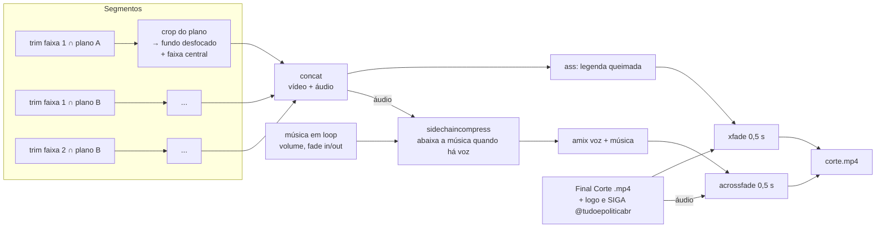
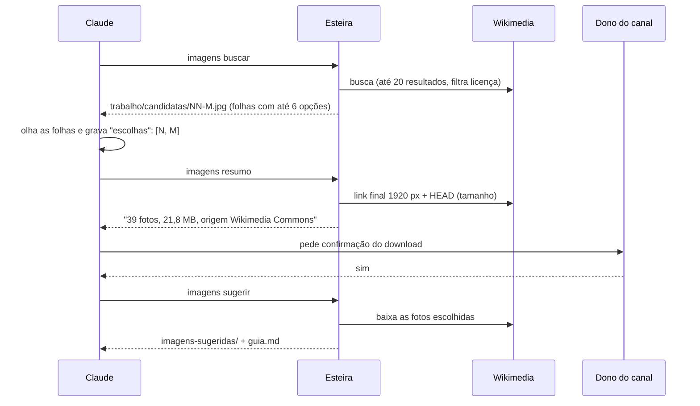

> **Documento histórico.** Descreve a esteira de 05/11/2026, antes do painel, das imagens no vídeo e da publicação.
> O estado atual está no [README](../README.md), em [`operacao.md`](operacao.md) e no [CHANGELOG](../CHANGELOG.md).

# Esteira de cortes do Tudo é Política: como funciona

Relatório de arquitetura. Data: 2026-11-05. Base: código em `Automacao/esteira/`
(28 módulos, cerca de 3.800 linhas), `docs/operacao.md`, specs em
`docs/superpowers/specs/` e resultados em `docs/resultados/`.

---

## 1. Visão geral

A esteira transforma um episódio horizontal gravado (por exemplo, *Entre
Assuntos #03*) em 8 a 10 cortes verticais (1080x1920, 30 fps) prontos para
TikTok, Shorts e Instagram. Cada corte sai com legenda queimada, pausas
removidas, música de fundo, zoom em quem fala e encerramento do canal. As
imagens ilustrativas **não** entram no vídeo: a esteira deixa uma pasta com
fotos sugeridas e um guia, e o dono do canal as insere no CapCut.

O sistema tem **duas metades** que trabalham juntas:

| Quem | Faz o quê |
|---|---|
| **Scripts Python** (`esteira`) | Trabalho mecânico e determinístico: transcrever, separar vozes, detectar rostos, calcular zoom, limpar pausas, montar legenda, escolher música, renderizar com ffmpeg, buscar e preparar fotos. |
| **Claude Code** (sessão interativa) | Trabalho de julgamento: escolher os trechos, escolher os momentos e as fotos, escrever os textos de post e o calendário, conferir as folhas de contato, corrigir nomes. |

Não há chave de API nem servidor. Tudo roda localmente no notebook do dono do
canal (Windows 11, RTX 4060 8 GB). O Claude Code chama a CLI pelo terminal e
lê/escreve os arquivos JSON e Markdown que ligam uma etapa à outra.



Hexágonos = decisão do Claude. Retângulos = comandos da CLI.

---

## 2. Princípios de projeto

1. **Regras editoriais fora do código.** O estilo do canal fica em
   `Contexto/*.md` (canal, estilo dos cortes, legenda, imagens, redes,
   glossário). O código só lê o `glossario.md`; o resto orienta o Claude.
2. **Cada etapa grava em disco e pode ser refeita sozinha.** As etapas se
   comunicam por arquivos (`palavras.json`, `vozes.json`,
   `enquadramento.json`, `montagem.json`...). Nada fica só em memória.
3. **Não sobrescreve sem `--forcar`.** Se o resultado já existe, o comando
   para com erro. Isso protege edições manuais.
4. **Um corte com erro não derruba os outros.** Todos os comandos por corte
   devolvem `{número: "ok" | "ok com alertas: ..." | "erro: ..."}`.
5. **Escrita confinada.** `caminhos.garantir_escrita()` recusa qualquer
   gravação fora de `2 - Cortes/` e `Automacao/`. `1 - Programas/` é
   somente leitura.
6. **Humano no fim.** A aprovação é o vídeo salvo em `video-final/`, que a
   esteira nunca toca. Nada é publicado.
7. **Lógica pura separada de I/O.** Partes centrais (`enquadrar.py`,
   `limpeza.py`, `legenda.py`, `pessoas.ligar`) recebem dados e devolvem
   dados, sem modelo nem ffmpeg, para serem testadas sozinhas. Funções com
   efeito externo recebem dependências injetáveis (`detectar=`, `consultar=`,
   `baixar=`, `criar_modelo=`), trocadas por falsos nos testes.

---

## 3. Tecnologias

| Peça | Uso | Onde |
|---|---|---|
| Python 3.12 (`.venv` próprio) | Linguagem da esteira | `pyproject.toml` |
| **ffmpeg / ffprobe** próprios | Corte, filtros, render, medição de áudio, detecção de cena | `Automacao/bin/` |
| **faster-whisper** `large-v3` (CUDA) | Transcrição com tempo por palavra | `transcrever.py` |
| **pyannote** `speaker-diarization-3.1` (CUDA) | Quem fala e quando (diarização) | `vozes.py` (extra `vozes`) |
| **OpenCV YuNet** | Detecção de rostos | `rostos.py`, `modelos/*.onnx` |
| **OpenCV SFace** | Assinatura de rosto (mesma pessoa entre cenas) | `rostos.py` |
| **Pillow** | Folhas de contato, cartões de notícia, preparo de fotos, sobreposição do encerramento | `planos.py`, `pessoas.py`, `folhas.py`, `cartao.py`, `imagens.py` |
| **NVENC** (`h264_nvenc`), com recuo para `libx264` | Codificação do vídeo | `render.py` |
| **Wikimedia Commons API** | Busca de fotos com licença livre | `wikimedia.py` |
| **Incompetech** (Kevin MacLeod, CC BY 4.0) | Biblioteca de música | `musica.py` |
| pytest | 321 testes em 27 arquivos | `tests/` |

O token do Hugging Face (para o pyannote) vem só da variável `HF_TOKEN` e é
mascarado em qualquer mensagem de erro (`vozes._sem_token`).

---

## 4. Estrutura de pastas

```text
Tudo é Política/
  1 - Programas/                 episódios gravados (somente leitura)
  2 - Cortes/                    saída da esteira
    <Quadro NN - Convidado>/
      episodio.json              vídeo de origem, duração, tamanho
      transcricao/
        texto.md                 transcrição legível com [hh:mm:ss]
        palavras.json            cada palavra com início e fim
        vozes.json               trechos de voz V1, V2, V3...
        pessoas.json             ligação voz→pessoa, assinaturas, nomes
        pessoas.jpg              folha: rosto, voz e tempo de fala
      aprovados.json             cortes escolhidos (Claude)
      candidatos.md              escolhidos e descartados, com motivo
      calendario.md              datas de publicação (Claude)
      revisao.md                 resumo para o dono do canal
      NN-titulo/
        corte.mp4                entrega
        post.md                  textos das redes (Claude)
        imagens-sugeridas/       guia.md + MMSS-nome-K.jpg + MMSS-nome.png
        video-final/             do dono do canal; a esteira nunca grava aqui
        trabalho/                arquivos intermediários (ver seção 6)
  3 - Identidade/                logos e 4 vídeos "Final Corte"
  Contexto/                      regras do canal
  Automacao/                     código (repositório git, 109 commits)
    esteira/                     pacote Python
    tests/                       testes automáticos
    bin/                         ffmpeg.exe, ffprobe.exe
    modelos/                     YuNet e SFace (.onnx)
    musicas/                     faixas por clima + catalogo.json, uso.json
    assets/                      fonte Montserrat Bold, encerramento.png
    docs/                        operação, specs, planos, resultados
```

Vídeos, músicas, modelos, `bin/` e `.venv/` ficam fora do git (`.gitignore`).

---

## 5. Mapa dos módulos



| Módulo | Responsabilidade |
|---|---|
| `cli.py` | Ponto de entrada (`python -m esteira <comando>`). Traduz argumentos, chama o fluxo e imprime o resultado por corte. Erros conhecidos viram `Erro: ...` com código 1. |
| `caminhos.py` | Todos os caminhos do projeto e a trava `garantir_escrita`. |
| `modelos.py` | Tipos básicos: `Palavra`, `Corte`, `Edicao`, `Cue`. |
| `midia.py` | Chamadas ao ffmpeg/ffprobe: sondar vídeo, medir duração e pico de áudio. |
| `rede.py` | HTTP com User-Agent próprio e nova tentativa em 429 (respeita `Retry-After`). |
| `episodio.py` | Cria a pasta do episódio e o `episodio.json`; recusa vídeo vertical ou sem áudio, e pasta que já pertence a outro vídeo. |
| `transcrever.py` | Whisper na GPU, com recuo em falta de memória. Lê nomes do glossário. |
| `vozes.py` | Diarização com pyannote. |
| `validar.py` | Confere os cortes de `aprovados.json`. |
| `rostos.py` | Detecta rostos e agrupa em pessoas. |
| `pessoas.py` | Liga voz a pessoa e gera `pessoas.jpg`. |
| `enquadrar.py` | Lógica pura do zoom: divide a cena por quem fala e calcula `x`, `y`, `zoom`. |
| `planos.py` | Tipo `Plano`, detecção de cena, cálculo do recorte e folha `planos.jpg`. |
| `fluxo_planos.py` | Orquestra o comando `planos`. |
| `limpeza.py` | Decide o que remover (pausas, hesitações, repetições) e remapeia tempos. |
| `legenda.py` | Monta as telas de legenda, aplica glossário e caixa, escreve SRT e ASS. |
| `receita.py` | O `montagem.json`: tudo o que o render precisa. |
| `musica.py` | Biblioteca de música: proposta, download, normalização, escolha por clima. |
| `cortar.py` | Comando `preparar`, mais utilidades de pasta de corte. |
| `montar.py` / `render.py` | Comando `montar`: monta o filtro do ffmpeg e codifica `corte.mp4`. |
| `pedidos.py` | Formato e validação do `pedidos.json` (momentos de imagem). |
| `publicar/` | Comando `publicar`: `post.py` (textos), `fila.py` (`postagens.json` e trava), `agendar.py` (resumo e confirmação), `rodar.py` (publica o que venceu), `envio.py`, `youtube.py`, `instagram.py`, `tiktok.py`, `credenciais.py` (Gerenciador de Credenciais do Windows), `tarefa.py` (Agendador). |
| `wikimedia.py` | Busca na API do Commons, filtro de licença, link final e tamanho. |
| `folhas.py` | Folha de contato das fotos candidatas. |
| `imagens.py` | Preparo da foto em 1080x1920 e prefixo `MMSS`. |
| `cartao.py` | Cartão de notícia do canal e a sobreposição do encerramento. |
| `fluxo_imagens.py` | Orquestra `imagens buscar / resumo / sugerir` e escreve o `guia.md`. |
| `revisao.py` | Gera o `revisao.md`. |

---

## 6. Os arquivos que ligam as etapas

| Arquivo | Quem grava | Quem lê | Conteúdo |
|---|---|---|---|
| `episodio.json` | `transcrever` | todos | Caminho do vídeo, quadro, número, convidado, duração. |
| `transcricao/palavras.json` | `transcrever` | `validar`, `preparar`, `planos`, `revisao` | `[{texto, inicio, fim}]` |
| `transcricao/vozes.json` | `vozes` | `planos` | `{"trechos": [{inicio, fim, voz}]}` |
| `transcricao/pessoas.json` | `planos` (e correção manual) | `planos` | `ligacao` `{V1: P2}`, `assinaturas` SFace, `nomes` `{P2: "Arthur"}` |
| `aprovados.json` | Claude | quase todos | `{numero, titulo, inicio, fim, clima, instagram, data}` |
| `trabalho/rostos.json` | `planos` | `planos` (cache) | Limites de cena e detecções; vale só se `inicio/fim` do corte não mudaram. |
| `trabalho/enquadramento.json` | `planos` (ou à mão) | `preparar`, `montar` | `{"planos": [{inicio, fim, x, y, zoom}]}` |
| `trabalho/alertas-planos.json` | `planos` | `preparar` | Alertas de quem fala, tempo relativo ao corte. |
| `trabalho/montagem.json` | `preparar` / `musica` | `montar`, `imagens` | A **receita**: faixas mantidas, planos, legenda, música, encerramento. |
| `trabalho/legenda.srt` | `preparar` | Claude (momentos), CapCut | Legenda editável. |
| `trabalho/edicoes.md` | `preparar` | humano | Lista de cada pausa, hesitação ou repetição removida. |
| `trabalho/registro.json` | `preparar` / `montar` | `revisao` | Resultado, alertas, versão do ffmpeg, data. |
| `trabalho/pedidos.json` | Claude, depois `imagens` | `imagens` | Momentos, candidatas, escolhas, URLs, tamanhos. |
| `trabalho/sugeridas.json` | `imagens sugerir` | `imagens sugerir` | Arquivos que a própria esteira gravou (só esses podem ser apagados). |
| `musicas/catalogo.json` | `musicas baixar` | `preparar`, `musica` | Faixas aprovadas, clima, duração, crédito. |
| `musicas/uso.json` | `preparar`, `musica` | idem | Última faixa usada por corte, para não repetir. |

**Duas linhas do tempo.** Os tempos de `aprovados.json`, `vozes.json` e
`enquadramento.json` estão na linha do **episódio**. Os da legenda, dos
alertas finais e do `pedidos.json` estão na linha do **`corte.mp4`**, depois
da remoção das pausas. A conversão é feita por `limpeza.remapear()`, a partir
das *faixas mantidas* do corte.

---

## 7. O fluxo, etapa por etapa

### 7.1 `transcrever`

```
python -m esteira transcrever "<video>" --quadro "Entre Assuntos" --numero 3 --convidado "Arthur Cerqueira"
```

1. `episodio.criar_episodio` sonda o vídeo com ffprobe, exige horizontal e com
   áudio, cria `2 - Cortes/Entre Assuntos 03 - Arthur Cerqueira/` e grava
   `episodio.json`. Se a pasta já existe para outro vídeo, para.
2. `transcrever.transcrever` roda faster-whisper em português, com tempo por
   palavra, filtro de voz (VAD) e os nomes do glossário como `initial_prompt`
   (até 200 caracteres), para o modelo acertar nomes próprios.
3. **Recuo em falta de memória:** tenta `large-v3 float16` → `large-v3
   int8_float16` → `medium int8_float16`. Outro erro qualquer é repassado.
4. Grava `texto.md` e `palavras.json` de forma atômica (arquivo `.tmp` e
   depois `replace`), para não deixar transcrição parcial.

As DLLs CUDA (cuBLAS, cuDNN) vêm de pacotes pip da NVIDIA e são registradas
em tempo de execução (`_registrar_dlls_nvidia`).

### 7.2 `vozes`

```
python -m esteira vozes "<video>" "<pasta do episódio>" --pessoas 3
```

Extrai o áudio em WAV mono 16 kHz, roda o pyannote com `num_speakers` fixo e
renomeia os rótulos do modelo para `V1, V2, V3` na ordem em que aparecem.
Grava `vozes.json`. Sem `HF_TOKEN`, sem o extra `vozes` instalado ou com falha
do modelo, para com mensagem clara (o token nunca aparece).

No teste real: 127 s para 45 min de episódio, 3 vozes, 492 trechos.

### 7.3 Escolha dos cortes (Claude)

O Claude lê `texto.md` e as regras de `Contexto/` e grava `aprovados.json`
(até 8 a 10 cortes, `clima` entre `leve`, `tenso`, `inspirador`, `reflexivo`,
`instagram: true` nos 4 mais fortes) e `candidatos.md` (inclusive os
descartados e o motivo).

### 7.4 `validar`

`validar.validar_trecho` confere, para cada corte:

- tempos dentro da duração do vídeo;
- duração entre 60 e 120 s;
- clima válido;
- início e fim batem com uma palavra real (tolerância de 0,25 s);
- **não começa nem termina no meio da frase**: a palavra anterior ao início
  (ou a última do corte) precisa terminar em `.`, `?` ou `!`, ou haver uma
  pausa de mais de 0,7 s.

O `preparar` repete essa validação e recusa corte inválido.

### 7.5 `planos`: quem fala e onde dar zoom

É a parte mais elaborada. Orquestrada por `fluxo_planos.planejar_episodio`.



**Cenas.** O filtro `select='gt(scene,0.1)'` do ffmpeg acha as trocas de
câmera; cenas com menos de 0,25 s são ignoradas.

**Rostos (`rostos.py`).** O ffmpeg extrai um quadro a cada 0,5 s, em 640 px de
largura. YuNet detecta rostos (score ≥ 0,8, altura ≥ 6% do quadro). Cada
rosto recebe uma assinatura SFace (vetor). Os modelos são carregados por
buffer, porque o OpenCV no Windows não abre caminho com acento ("Tudo é
Política").

**Agrupamento.** Cada detecção vai para a pessoa conhecida de maior cosseno,
se ≥ 0,363 (limiar do SFace); senão cria `Pn` nova. A assinatura da pessoa é a
média normalizada. Assinaturas de um `pessoas.json` anterior entram como
ponto de partida, então os códigos `P1, P2...` se mantêm entre rodadas.

**Rosto por cena.** Uma pessoa só conta numa cena se aparece em pelo menos
metade das amostras. O rosto da cena é a média das caixas.

**Ligação voz→pessoa (`pessoas.ligar`).** Só usa cenas com **exatamente um
rosto** (close): quem fala ali é quem se vê. Soma o tempo de cada par
(voz, pessoa), atende os pares do maior para o menor e nunca liga duas vozes à
mesma pessoa. Um par só vale com ≥ 2 s e ≥ 10% da fala total da voz, para um
"vazamento" curto não ligar errado. Gera `pessoas.jpg` com o melhor recorte de
cada pessoa e a legenda `P2 = V3 · Arthur · 312 s de fala`.

`pessoas.json` existente manda: a ligação e os nomes ficam como estão
(inclusive correções manuais). `--forcar` só acrescenta vozes ainda sem
pessoa; `--religar` recalcula a ligação do zero, mantendo os nomes.

**Convidado.** É a pessoa ligada à voz que mais fala no episódio
(`convidado_do_episodio`).

**Enquadramento (`enquadrar.py`, lógica pura).** Para cada cena:

1. Pega os turnos de voz da cena; turnos com menos de 2 s ("uhum", "é") são
   ignorados.
2. Divide a cena nos pontos de troca de voz. Silêncio continua com quem
   falava antes.
3. Fala sobreposta por mais de 1 s: mantém o enquadramento anterior e alerta.
4. Junta trechos com menos de 2 s ao vizinho.
5. Escolhe o rosto de cada trecho:
   - quem fala aparece → o rosto dele;
   - quem fala não aparece e há um rosto só → esse rosto;
   - vários rostos → o convidado (reação); sem convidado → zoom 1,0 no
     centro do grupo;
   - nenhum rosto → centro, zoom 1,0, alerta.
6. Trechos vizinhos com o mesmo enquadramento se fundem. A troca é corte seco.

**Nível de zoom.** `zoom = 0,28 / altura do rosto`, limitado a 2,0 e
arredondado para o nível mais próximo de **1,0 / 1,35 / 1,7 / 2,0**. Close já
grande dá 1,0 sozinho. O `x` centraliza o rosto; o `y` põe os olhos
(`centro do rosto − 10% da altura`) no terço superior do recorte
(`y = olhos + 1/(6·zoom)`).

**Folha `planos.jpg`.** Um quadro por plano, com a caixa amarela do rosto
escolhido, o nome de quem fala e as primeiras 6 palavras. Serve para o Claude
conferir sem assistir ao vídeo.

`enquadramento.json` existente não é sobrescrito sem `--forcar`: a edição
manual vence. `--numero N` limita o enquadramento a um corte, mas a ligação
usa sempre todos os cortes do episódio.

### 7.6 `preparar`: a receita do corte

`cortar.preparar_episodio`, para cada corte:

**1. Limpeza (`limpeza.planejar_limpeza`).** Percorre as palavras do trecho e
marca para remover:

- **hesitações**: `hum`, `hã`, `ahn`, `éé`, `hmm`, `ãh`, `eh`;
- **repetições**: a mesma palavra duas vezes seguidas com menos de 0,5 s
  entre elas (exceto `né`, `tá`, `não` e palavras que fecham frase);
- **pausas** de mais de 0,5 s, que encolhem para 0,15 s.

O resultado são as **faixas mantidas**: lista de intervalos `(de, até)` na
linha do episódio. Cada remoção vai para `edicoes.md`, para revisão humana.

**2. Legenda (`legenda.py`).**

- `corrigir_palavras`: troca grafias erradas pelos nomes do glossário,
  comparando sem acento e sem caixa, nomes compostos primeiro.
- Remapeia cada palavra para a linha do `corte.mp4`; palavra cujo meio caiu
  numa parte removida some.
- Tudo em minúsculas, exceto nomes do glossário e siglas.
- Telas de 3 a 6 palavras, até 2 linhas de 28 caracteres, quebrando em
  pontuação natural e equilibrando as duas linhas. Sem pontuação no fim.
- Grava `legenda.srt`. No render vira ASS: Montserrat 90, branca, contorno
  preto 3, posição `(540, 1530)`, cerca de 80% da altura.

**3. Receita (`montagem.json`).** Junta faixas, planos do
`enquadramento.json`, telas de legenda, música e `encerramento: true`.

**4. Música (`musica.atualizar_musica`).** Escolhe uma faixa do clima do
corte em `catalogo.json`:

- evita as 10 faixas usadas mais recentemente em outros cortes (`uso.json`,
  compartilhado entre episódios);
- prefere faixa com duração ≥ a do corte;
- entre as restantes, a usada há mais tempo.

Volume fixo de −20 dB. Sem faixa para o clima, o corte sai sem música e com
alerta.

**5. Alertas.** Os de `alertas-planos.json` são convertidos para o tempo do
`corte.mp4` (`_no_tempo_do_corte`). Corte sem `enquadramento.json` sai no
centro, zoom 1,0, com alerta. Tudo vai para `registro.json`.

O `preparar` é rápido (cerca de 1 s para 10 cortes).

### 7.7 `montar`: o render

`montar.montar_episodio` lê a receita. Se o `enquadramento.json` existe, ele
manda (editar o zoom depois do `preparar` vale direto no `montar`). Valida
zoom entre 1,0 e 2,0, música existente e volume entre −30 e −18 dB (padrão −26 dB).

`render.renderizar_final` monta **um único `filter_complex` do ffmpeg**:



- **Segmentos.** `planos.dividir_em_segmentos` cruza as faixas mantidas com
  os planos: cada pedaço tem um intervalo e um enquadramento. Cada um vira
  `trim` + `atrim`, e depois tudo é unido com `concat`. É assim que as pausas
  somem e o zoom troca em corte seco.
- **Layout 9:16 (`filtro_9x16`).** O recorte do plano (`planos.recorte`) tem
  a proporção da faixa (1080:1036) e altura `altura do vídeo / zoom`, sem
  nunca sair da imagem. Ele é usado duas vezes: ampliado para 1080x1920 com
  desfoque forte (`gblur sigma=40`) como **fundo**, e redimensionado para
  1080x1036 como **faixa central**, sobreposta em `y = 442` (23% a 77% da
  altura).
- **Busca rápida.** O vídeo de entrada é aberto com `-ss` 1 s antes da
  primeira faixa, para não decodificar o episódio inteiro.
- **Música.** Toca em loop (`-stream_loop -1`), com fade de entrada de 0,5 s
  e de saída de 1,5 s, e passa por um *sidechain compressor* controlado pela
  voz (ducking): abaixa sozinha quando alguém fala.
- **Encerramento.** Um dos 4 vídeos *Final Corte*, em rodízio pelo número do
  corte. Por cima, `assets/encerramento.png` (logo + "SIGA
  @tudoepoliticabr", gerada por `cartao.gerar_sobreposicao`) entra com fade de
  0,4 s. A passagem é um `xfade` de 0,5 s no vídeo e `acrossfade` no áudio.
- **Codificação.** Tenta `h264_nvenc` (GPU, `cq 19`); se falhar, `libx264
  crf 18`. Saída yuv420p, AAC 192 kbps, 44,1 kHz, estéreo.
- **Verificações.** Grava em `.tmp.mp4`, confere que a duração real bate com a
  esperada (±0,5 s), mede o pico de áudio (alerta acima de −0,5 dB) e só
  então renomeia para `corte.mp4`.

No fim, cria `imagens-sugeridas/` e `video-final/` vazias. No teste real:
360 s para 10 cortes.

### 7.8 Imagens sugeridas

O Claude lê `legenda.srt` e grava `trabalho/pedidos.json` com 4 a 6
**momentos** por corte. Três tipos:

| Tipo | Campos | O que a esteira faz |
|---|---|---|
| `foto` | `busca` | Busca no Wikimedia Commons, baixa e prepara. |
| `noticia` | `titulo`, `veiculo`, `data` | Gera um cartão do canal (fundo preto, logo, manchete, "Fonte: veículo, data"). Nunca imita a página do veículo. |
| `ia` | `prompt` | Só escreve o prompt no `guia.md`. Não gera nada. |

`pedidos.validar_pedidos` recusa, entre outras coisas, **prompt de IA que
cita uma pessoa do glossário** (seções Apresentadores, Convidados, Pessoas):
nunca se gera imagem de IA de pessoa real.

Os três passos, com a única pausa do fluxo no meio:



- **Busca (`wikimedia.py`).** Só aceita JPEG, PNG ou WebP com lado menor ≥ 800
  px e licença **CC0, domínio público, CC BY ou CC BY-SA** (recusa NC e ND).
  Espaça as consultas em 2 s e tenta de novo se a API estiver ocupada.
- **Folhas (`folhas.py`).** Grade 3x2 com miniatura, orientação, autor e
  licença, para escolher **olhando a foto, não o título**.
- **Resumo.** Resolve o link final e soma os tamanhos **sem baixar**. Grava em
  `pedidos.json` quais escolhas foram resumidas (`resumidas`).
- **Sugerir.** Só roda se as escolhas atuais forem as mesmas do último resumo,
  ou seja, o download que o dono confirmou. Antes, apaga apenas os arquivos
  que a própria esteira gravou (`sugeridas.json`); um arquivo com o mesmo nome
  que não está nessa lista é mantido ("arquivo do dono mantido").
- **Preparo (`imagens.preparar_foto`).** Foto vertical (altura ≥ 1,5 x
  largura) cobre a tela 1080x1920. Horizontal ou quadrada fica inteira na
  faixa central, sobre ela mesma ampliada e desfocada.
- **Tempos.** `ajustar_tempos` leva cada momento para 2 a 5 s na tela, numa
  cópia (o `pedidos.json` não muda).
- **Nomes.** `MMSS-nome-K.jpg` (fotos, K de 1 a 3) e `MMSS-nome.png`
  (notícia), em que `MMSS` é o início no `corte.mp4`. Assim os arquivos ficam
  na ordem do vídeo ao importar no CapCut.
- **`guia.md`.** Lembretes de estilo no topo e um bloco por momento: tempo,
  fala, arquivos, créditos (autor, licença, link) ou o prompt de IA. Falha de
  download vira "Sem imagem: motivo".

### 7.9 Textos e calendário (Claude)

O Claude escreve `post.md` (YouTube, Instagram, TikTok, com o crédito exato
da música vindo do `montagem.json`) e `calendario.md` (TikTok e Shorts todos
os cortes, Instagram só os 4 marcados, tudo antes do próximo episódio). A data
de cada corte vai para o campo `data` de `aprovados.json`.

### 7.10 `revisao`

`revisao.escrever_revisao` gera `revisao.md` com um bloco por corte: link do
`corte.mp4` e do `guia.md`, redes, data, música, as 15 palavras antes e depois
do trecho (para checar se o sentido não mudou), se `video-final/` está vazia e
os alertas do `registro.json`. O Claude acrescenta os nomes duvidosos da
legenda e para. O dono do canal coloca as imagens no CapCut e salva o vídeo em
`video-final/`.

---

## 8. Biblioteca de música

Fluxo separado, feito uma vez:

1. `musicas propor`: baixa o catálogo JSON do Incompetech e classifica cada
   faixa por clima a partir das marcações (`feel`):
   `leve` = bright, bouncy, humorous; `tenso` = suspenseful, driving,
   intense; `inspirador` = uplifting, epic; `reflexivo` = calming, relaxed,
   somber. Exclui faixas sombrias ou agressivas (eerie, dark, aggressive...),
   com voz ou coro, e fora de 90 a 360 s. Pontua instrumentos leves (piano,
   cordas, violão) acima de pesados (bateria, metais). Grava `proposta.md` e
   `aprovadas.json` (10 por clima).
2. O dono do canal ouve e aprova.
3. `musicas baixar`: baixa só as aprovadas, normaliza a loudness
   (`loudnorm I=-16`), grava em `musicas/<clima>/` e atualiza
   `catalogo.json` com o crédito pronto. Faixa já baixada não é baixada de
   novo.

Hoje há 40 faixas (10 por clima).

---

## 9. Segurança e proteções

| Proteção | Como é aplicada |
|---|---|
| Não escrever em `1 - Programas/` | `garantir_escrita` em todo comando que grava. |
| Não sobrescrever trabalho | `FileExistsError` / "use --forcar" em transcrição, vozes, receita, `corte.mp4`, proposta de música. |
| Edição manual vence | `enquadramento.json` e `pessoas.json` existentes são mantidos. |
| `video-final/` intocável | Nenhum código grava, apaga ou lista para apagar nela. |
| Só apagar o que a esteira criou | `sugeridas.json` lista as fotos geradas. |
| Download só com confirmação | `resumo` mede sem baixar; `sugerir` exige que as escolhas batam com o resumo. |
| Sem IA de pessoa real | Prompt com nome do glossário é recusado. |
| Sem imitar veículo | O cartão de notícia é sempre o layout do canal. |
| Licença livre | Filtro de licença na busca; créditos no `guia.md`. |
| Token protegido | Só por `HF_TOKEN`, mascarado nos erros. |
| Arquivo pela metade | Gravação atômica (`.tmp` + `replace`) na transcrição, vozes, pessoas e no `corte.mp4`. |

---

## 10. Testes

27 arquivos em `tests/`, 321 funções de teste (o último resultado registrado
é "331 passando", contando casos parametrizados). Cada módulo tem o seu
arquivo. Os modelos (Whisper, pyannote, YuNet/SFace) e a rede são trocados
por falsos via injeção de dependência; os testes de render usam vídeos curtos
gerados com o próprio ffmpeg (`tests/auxiliares.py`).

```bash
.venv\Scripts\python.exe -m pytest
```

---

## 11. Estado atual e pontos de atenção

Resultado do último teste real (`docs/resultados/2026-teste-capcut-f1.md`,
Entre Assuntos #03, 10 cortes): todos os `corte.mp4` saíram ok; 39 fotos
sugeridas (21,8 MB).

Pontos conhecidos:

1. **Ligação voz→pessoa depende de closes sozinhos.** No #03 os
   apresentadores nunca aparecem sozinhos em close, então só o convidado foi
   ligado automaticamente. A correção foi feita à mão em `pessoas.json`. A
   ligação por eliminação nos planos com dois rostos está pendente.
2. **O agrupamento pode dividir uma pessoa em duas** (perfil e frente viraram
   P3 e P5). Não afetou o enquadramento no teste, mas pode afetar em outro
   episódio.
3. **Nomes dos apresentadores** em `pessoas.json` ainda são descrições
   ("camisa verde", "camisa escura").
4. **Áudio perto de saturar** em um corte (−0,1 dB). A esteira só alerta, não
   corrige.
5. **Documentação antiga.** A spec de 2026-11-01 descreve a primeira versão
   (recorte central fixo, `corte-sem-legenda.mp4`, sem detecção de rosto). O
   que vale hoje é `docs/operacao.md` e a spec de 2026-11-05.
6. **Código remanescente.** `legenda.py` e `receita.py` ainda suportam
   `destaque` (palavra em amarelo), mas a regra atual é legenda toda branca e
   o `preparar` nunca preenche esse campo.
7. **`musicas/uso.json` é compartilhado** entre episódios e é gravado pelo
   `preparar`. Refazer o `preparar` de um corte antigo muda a ordem de
   rodízio das músicas dos próximos.
8. **Scripts soltos em `Automacao/.superpowers/`** (`achar.py`,
   `calendario.py`, `textos.py`...) são rascunhos de sessões anteriores, fora
   do git e fora do pacote.

---

## 12. Referência rápida de comandos

Todos a partir de `Automacao/`, com `.venv\Scripts\python.exe -m esteira`.

| Comando | Faz | Opções |
|---|---|---|
| `transcrever <video> --quadro --numero --convidado` | Cria o episódio e transcreve | `--forcar` |
| `vozes <video> <pasta>` | Separa as vozes | `--pessoas N`, `--forcar` |
| `validar <pasta>` | Confere `aprovados.json` | |
| `planos <pasta>` | Rostos, ligação, enquadramento, folhas | `--numero N`, `--forcar`, `--religar` |
| `preparar <pasta>` | Pausas, legenda, música, receita | `--numero N`, `--forcar` |
| `musica <pasta>` | Recalcula a música da receita | `--numero N` |
| `montar <pasta>` | Renderiza `corte.mp4` | `--numero N`, `--forcar` |
| `imagens buscar\|resumo\|sugerir <pasta>` | Fluxo das fotos | `--numero N` |
| `revisao <pasta>` | Gera `revisao.md` | |
| `cartao --manchete --veiculo --data --saida` | Gera um cartão de notícia avulso | |
| `musicas propor\|baixar` | Biblioteca de música | `--forcar` (propor) |
| `publicar agendar <pasta> --numero N --data` | Resumo; com `--confirmar`, agenda | `--redes`, `--confirmar` |
| `publicar fila\|rodar\|cancelar\|marcar\|conectar\|instalar-tarefa` | Fila e contas das redes | ver `operacao.md`, etapa 11 |
